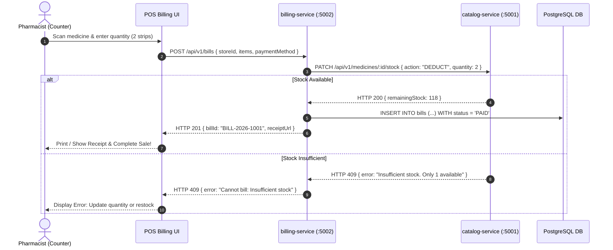

# MediGrid Pharmacy Inventory & In-Store Billing Architecture

## 1. Executive Summary & Vision

MediGrid is an enterprise **In-Store Pharmacy Inventory Management & Point-of-Sale (POS) Billing System** combined with a **Public Real-Time Medicine Availability Discovery Portal**.

### Core Value Proposition:
1. **Public Discovery (Read-Only)**: Consumers can search any medication and instantly see real-time availability, price, and store location without online ordering.
2. **Staff Inventory Management**: Pharmacists manage catalog, batches, expiry dates, and unit prices.
3. **In-Store POS & Billing**: Counter billing generates customer invoices and **atomically decrements stock** in real time.
4. **Single-Store to Multi-Tenant Ready**: Designed for a single medical store in v1, with a built-in `store_id` partition key enabling seamless multi-tenant scaling in v2.

---

## 2. Microservice Topology

```
                              ┌──────────────────────────────────────────────┐
                              │           API GATEWAY / K8S INGRESS          │
                              └──────┬────────────────────────────────┬──────┘
                                     │                                │
                     /api/v1/medicines/*                      /api/v1/bills/*
                                     │                                │
                                     ▼                                ▼
                     ┌──────────────────────────────┐ ┌──────────────────────────────┐
                     │       catalog-service        │ │       billing-service        │
                     │         (Port 5001)          │ │         (Port 5002)          │
                     │  (Inventory & Public Search) │ │   (In-Store POS & Invoicing) │
                     └──────────────┬───────────────┘ └──────────────┬───────────────┘
                                    │                                │
                                    │ ◀── Atomic Stock Deduction ────┤
                                    │     (HTTP / Distributed Sync)  │
                                    ▼                                ▼
                             ┌─────────────┐                  ┌─────────────┐
                             │    Redis    │                  │ PostgreSQL  │
                             │ (Fast Cache)│                  │(Invoices/DB)│
                             └─────────────┘                  └─────────────┘
```

---

## 3. Service 1: `catalog-service` (Port 5001)

### Role & Domain
Manages store profile, medication inventory records, batch tracking, and low-latency public medicine availability search.

### Multi-Tenant Ready Data Model (`medicines`)
```json
{
  "id": "med-uuid-001",
  "storeId": "store-001",
  "name": "Paracetamol 650mg",
  "genericName": "Acetaminophen",
  "category": "Antipyretic / Analgesic",
  "batchNumber": "BATCH-2026-X",
  "expiryDate": "2027-12-31",
  "price": 32.50,
  "stockQuantity": 120,
  "reorderLevel": 20,
  "inStock": true,
  "locationRack": "Shelf B-2"
}
```

### Core Endpoints
| Method | Path | Description | Access |
| :--- | :--- | :--- | :--- |
| `GET` | `/healthz` | Kubernetes Liveness Probe | Public |
| `GET` | `/ready` | Kubernetes Readiness Probe | Public |
| `GET` | `/api/v1/medicines/search` | Public search (`?q=paracetamol&storeId=store-001`) | Public |
| `GET` | `/api/v1/medicines/:id` | Fetch medicine details & stock status | Public / Staff |
| `POST` | `/api/v1/medicines` | Add new medicine to inventory | Staff / Admin |
| `PUT` | `/api/v1/medicines/:id` | Update medicine price/details | Staff / Admin |
| `PATCH`| `/api/v1/medicines/:id/stock` | Deduct or Restock inventory | Internal / Staff |

---

## 4. Service 2: `billing-service` (Port 5002)

### Role & Domain
In-store POS counter billing engine. Creates customer sales receipts and atomically decrements inventory stock.

### Multi-Tenant Ready Data Model (`bills`)
```json
{
  "billId": "BILL-2026-1001",
  "storeId": "store-001",
  "customerName": "John Doe",
  "customerPhone": "9876543210",
  "items": [
    {
      "medicineId": "med-uuid-001",
      "medicineName": "Paracetamol 650mg",
      "quantity": 2,
      "unitPrice": 32.50,
      "total": 65.00
    }
  ],
  "subtotal": 65.00,
  "taxAmount": 3.25,
  "discountAmount": 0.00,
  "finalTotal": 68.25,
  "paymentMethod": "UPI",
  "status": "PAID",
  "createdAt": "2026-11-06T01:00:00Z"
}
```

### POS Billing Workflow (Atomic Transaction)


---

## 5. Frontend UI Structure (Next.js 14)

```text
frontend/src/app/
├── (public)/
│   └── page.tsx              <-- Public Medicine Search & Live Availability Finder
│
└── (pharmacy)/
    ├── inventory/
    │   └── page.tsx          <-- Inventory Dashboard (Add, Edit, Restock Medicine)
    │
    └── pos/
        └── page.tsx          <-- In-Store Billing Counter (Search, Add to Bill, Print Receipt)
```
